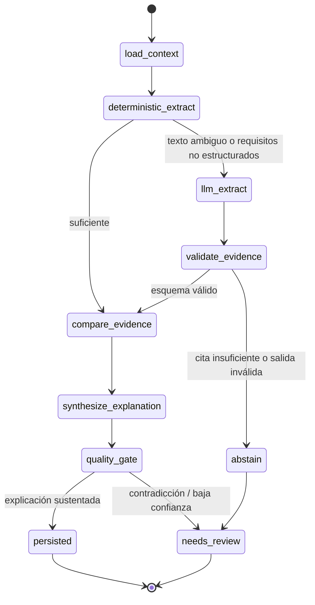

# Rolekai — Agent Design v1.0

## 1. Regla de diseño

Un “agente” existe solo cuando debe interpretar lenguaje, manejar incertidumbre o requerir una aprobación reanudable. Los conectores, dedupe exacto, filtros de ubicación, persistencia y estados son funciones y servicios deterministas.

| Componente | Estado v1.0 | Ejecución | Uso de LLM |
| --- | --- | --- | --- |
| Rolekai Hunter | servicio de orquestación, no agente autónomo | worker + conectores | opcional y fuera de P0 para extracción de URL difícil. |
| Rolekai Evaluator | agente/workflow acotado | LangGraph, bajo demanda | sí: extracción semántica y síntesis basada en evidencia. |
| Rolekai Tailor | reservado P2 | no se ejecuta | futuro, con aprobación obligatoria. |
| Rolekai Monitor | reservado P2 | no se ejecuta | futuro, clasificación de señales autorizadas. |

## 2. Rolekai Hunter

Hunter coordina el pipeline de ingesta, pero cada paso usa una interfaz determinista: `Connector`, `Normalizer`, `DeduplicationService`, `EligibilityPolicy`, `JobRepository` y `ActivityWriter`. El único resultado permitido es un Job/observación/evento o un error clasificado. No recomienda postular ni llama a Application.

**Entradas:** configuración de fuente, URL manual, perfil de búsqueda mínimo.  
**Salidas:** `ImportRun`, `SourceObservation`, Job actualizado/creado/candidato a fusión, etiquetas de elegibilidad y trabajo de evaluación opcional.

## 3. Rolekai Evaluator

Evaluator produce una Evaluation inmutable y versionada; no modifica el Job, el perfil ni una Application. Parte del perfil aprobado y de una instantánea del Job para que el resultado sea reproducible.

### Estado del grafo

`evaluation_id`, `job_snapshot_id`, `profile_snapshot_id`, requisitos candidatos, citas de descripción, mapeos a evidencia de perfil, incertidumbres, versión de prompt/modelo y decisión de calidad. Se limita el contexto al texto necesario y no se guarda razonamiento interno del modelo como hecho de producto.

### Nodos deterministas

- Cargar snapshots autorizados y normalizar texto.
- Clasificar requisitos estructurados/campos de fuente.
- Comparar evidencia exacta, contar cobertura y aplicar reglas de score.
- Validar esquema, límites, citas y política de no invención.
- Persistir resultado, ActivityEvent y métricas.

### Nodos con LLM

- Extraer requisitos explícitos de una descripción sin estructura.
- Clasificar un requisito como requerido/preferido/beneficio solo con cita de texto.
- Redactar un resumen de compatibilidad que solo use entradas validadas.

El LLM debe poder devolver “desconocido/no suficiente evidencia”. Un campo sin cita se rechaza o se marca incierto, nunca se promociona a requisito confirmado.

## 4. Aprobación humana y fallos

- P0 no requiere aprobar la Evaluation para persistirla; sí requiere interacción humana para `saved`, fusión ambigua y creación de Application.
- Las futuras propuestas de Tailor se interrumpirán antes de crear/exportar una variante. LangGraph admite persistir checkpoints y reanudar un flujo humano; se usará solo para esos casos, no como estado del producto.
- Un fallo de conector no invoca al Evaluator. Un fallo de Evaluator crea una Evaluation `failed`/`needs_review` sin borrar la observación ni bloquear Discover.

## 5. Guardrails evaluables

1. Toda afirmación sobre requisito incluye uno o más `job_evidence_spans`.
2. Toda cobertura de habilidad enlaza `profile_evidence_id`; ausencia significa `unknown`, no “faltante” por inferencia.
3. El score se denomina `fit_score_relative` y no probabilidad.
4. El grafo no tiene herramientas que creen Applications, envíen formularios ni modifiquen evidencia.
5. Cambiar prompt, modelo o política genera una nueva versión de Evaluation, no sobrescribe la anterior.
