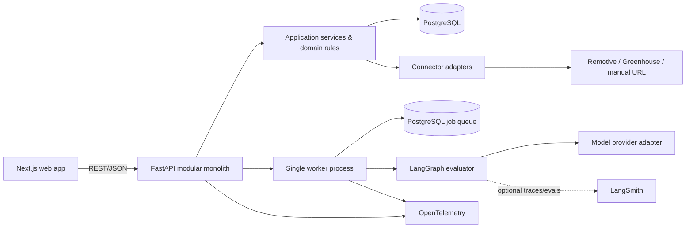
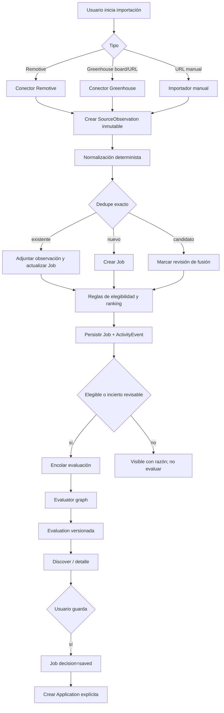

# Rolekai — Technical Architecture v1.0

**Estado:** diseño aprobado para planificación; no implica código.  
**Ámbito inicial:** un usuario, flujo P0: Remotive + URL manual + Greenhouse → Job → Evaluation → Save → Application manual.

## 1. Decisión arquitectónica

Rolekai será un **monolito modular** con una aplicación web Next.js/TypeScript y un backend Python/FastAPI. PostgreSQL será la fuente de verdad de los dominios y de los trabajos asíncronos. LangGraph se usará solo dentro del workflow de evaluación que necesita razonamiento, estado reanudable y aprobación humana; no convierte cada conector o tarea CRUD en un agente.

### Principios

1. **Una fuente de verdad:** datos de producto en PostgreSQL; los checkpoints de LangGraph no sustituyen entidades de negocio.
2. **Side effects idempotentes:** una ejecución puede reintentarse sin duplicar Jobs, Applications, observaciones ni eventos.
3. **LLM mínimo y verificable:** usarlo para extracción/clasificación semántica y síntesis; no para conectores, reglas de ubicación, dedupe exacto o transiciones de estado.
4. **Human-in-the-loop real:** una pausa conserva el estado y requiere una acción explícita para reanudar; no es solo un botón al final.
5. **Interfaces por contrato:** frontend, conectores, persistencia y agente dependen de DTOs/Pydantic, no de tablas ni de proveedores concretos.

## 2. Límites de módulos

| Módulo | Responsabilidad | No hace |
| --- | --- | --- |
| `identity` | usuario actual, propiedad y autorización. | no define lógica de búsqueda. |
| `profile` | preferencias de búsqueda y evidencia profesional. | no evalúa con LLM directamente. |
| `jobs` | Job, observaciones, normalización, dedupe y disponibilidad. | no crea Applications. |
| `connectors` | contratos y adaptadores de fuentes. | no decide relevancia ni modifica estados de negocio. |
| `evaluation` | requisitos, ejecuciones, evidencias y score relativo. | no inventa experiencia ni cambia Application. |
| `applications` | candidatura explícita, transiciones y notas. | no envía formularios. |
| `activity` | bitácora inmutable y proyecciones de timeline. | no es fuente de verdad de un estado. |
| `workflows` | encola, ejecuta, reintenta y reanuda procesos. | no contiene reglas de dominio duplicadas. |
| `api` | autenticación, validación, REST y mapeo de errores. | no accede directamente a proveedores. |

Los módulos viven en un solo despliegue y una sola base al inicio, pero usan interfaces internas y migraciones propias. No hay microservicios ni bus distribuido en v1.0.

## 3. Primer workflow end-to-end

**Invariante:** crear, actualizar o fusionar un Job nunca crea una Application. La creación de Application requiere un Job `saved` y confirmación del usuario.

## 4. Sincronía, asincronía y programación

| Tipo | Casos | Mecanismo v1.0 |
| --- | --- | --- |
| Síncrono | CRUD de perfil, lista/detalle de Jobs, guardar/descartar, crear Application. | request/response FastAPI; transacción corta. |
| Asíncrono | Importar lote, extraer URL, normalizar lote, evaluar Job, reintento. | fila `background_job` en PostgreSQL + proceso worker separado. API devuelve `202` y `job_run_id`. |
| Programado | Revisión de fuentes, verificación de cambios. | fuera de P0; un cron externo dispara un endpoint/command idempotente. Respetar límites de fuente. |

El worker reclama trabajos mediante bloqueo transaccional; el registro conserva `attempt_count`, `run_after`, `idempotency_key`, error clasificado y resultado. Una cola distribuida se reconsidera solo si un worker y PostgreSQL dejan de satisfacer latencia/volumen medidos.

## 5. Persistencia y estado

- PostgreSQL conserva entidades, relaciones, auditoría y la cola de tareas. Se usan claves UUID, `timestamptz`, restricciones, transacciones y `jsonb` solo para payloads flexibles de proveedores; los campos de consulta deben ser relacionales.
- Un `SourceObservation` es inmutable. La representación normalizada del Job es una proyección actual con procedencia por campo.
- Evaluation y Application tienen ciclos de vida propios; Activity es append-only.
- LangGraph usa un checkpointer persistente solo para una ejecución de evaluación/pausa. Al terminar, el servicio escribe la Evaluation en PostgreSQL en una transacción de dominio.

## 6. Errores y reintentos

| Clase | Ejemplos | Tratamiento |
| --- | --- | --- |
| Transitorio | timeout, DNS temporal, 429, 5xx. | reintento exponencial con jitter, máximo y `Retry-After`; no duplicar side effect. |
| Fuente/configuración | tablero inválido, 401/403, esquema cambiado. | detener reintentos automáticos, marcar conector/configuración y exponer error accionable. |
| Datos | HTML incompleto, URL inaccesible, campo conflictivo. | persistir evidencia disponible; `unknown`/`needs_review`, nunca rellenar con ficción. |
| LLM | salida inválida, límite, baja evidencia. | reintentar una vez si es transitorio; validar Pydantic; guardar fallo/abstención, no degradar a hecho. |
| Dominio | transición de Application no permitida. | `409` con motivo; no crear Activity de éxito. |

## 7. Seguridad y privacidad

- Propiedad (`owner_id`) y autorización se aplican en cada consulta/escritura desde v1, aunque haya un único usuario.
- Secretos y claves de proveedor fuera del repositorio y de logs; nunca en snapshots, trazas o mensajes al cliente.
- Sanitizar HTML de descripciones antes de renderizar y no permitir que una URL manual acceda a direcciones privadas, localhost o metadatos cloud (protección SSRF).
- Reducir datos de CV/evidencia enviados a un LLM al mínimo de la evaluación y registrar consentimiento/configuración del proveedor.
- Redactar PII, tokens, CV completo y cuerpo crudo de fuentes de OpenTelemetry/LangSmith; definir retención y eliminación antes de Gmail/multiusuario.

## 8. Observabilidad y pruebas

OpenTelemetry instrumenta solicitudes API, consultas externas, worker y trabajos. Las trazas llevan `request_id`, `owner_id` seudonimizado, `job_id`, `source`, `workflow_run_id` y clase de resultado, sin contenido sensible. LangSmith es opcional para trazas de prompts y evaluación offline; su uso queda sujeto a la política de datos.

La estrategia de pruebas se detalla en `TECH_DECISIONS.md`: unitarias de reglas/dominio, fixtures versionados de fuentes, integración con PostgreSQL, contratos de API y datasets de evaluación para el Evaluator.
