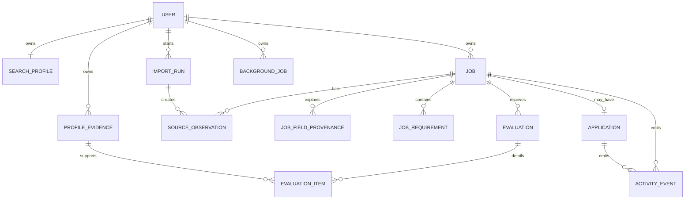

# Rolekai — Data Model v1.0

## 1. Relaciones principales

P0 permite una Application activa por `owner_id + job_id`; esa restricción puede relajarse con historial de repostulación en una iteración futura.

## 2. Agregados y tablas

| Agregado | Tablas principales | Fuente de verdad |
| --- | --- | --- |
| Identity/Profile | `user`, `search_profile`, `profile_preference`, `profile_evidence` | datos escritos por usuario. |
| Job | `job`, `source_observation`, `job_field_provenance`, `job_requirement`, `job_merge_candidate` | observaciones + proyección normalizada. |
| Evaluation | `evaluation`, `evaluation_item`, `evaluation_evidence_span` | snapshot versionado de Job y perfil. |
| Application | `application`, `application_transition` | acciones explícitas del usuario. |
| Activity | `activity_event` | append-only, emitido en la misma transacción del cambio de dominio. |
| Operations | `connector_config`, `import_run`, `background_job`, `workflow_run` | ejecución, no negocio. |

## 3. Campos y restricciones críticas

### Job

`id`, `owner_id`, `company_display_name`, `company_key`, `title_raw`, `title_normalized`, `canonical_url`, `apply_url`, `workplace_type`, `remote_eligibility`, `eligibility_reason`, `availability_status`, `discovery_status`, `decision_status`, `posted_at`, `discovered_at`, `last_verified_at`, `created_at`, `updated_at`.

- No contiene `application_status` ni `evaluation_status`.
- `remote_eligibility` = `eligible|ineligible|unknown|needs_review` y referencia evidencia.
- clave única parcial para `(owner_id, canonical_url)` cuando exista; los IDs de fuente viven en observaciones.

### SourceObservation y procedencia

`source_observation` es inmutable: `id`, `job_id`, `import_run_id`, `source_type`, `external_id`, `source_url`, `retrieved_at`, `source_updated_at`, `content_hash`, `raw_payload_json`, `original_description_html`, `original_description_text`, `attribution`, `parser_version`.

`job_field_provenance` mapea cada campo actual a observación, ruta de payload/cita, tipo (`source|rule|human|llm`) y confianza. Payloads JSON se mantienen para auditoría; campos de filtro se extraen a columnas relacionales.

### Evaluation

`evaluation` tiene `id`, `owner_id`, `job_id`, `job_snapshot_hash`, `profile_snapshot_hash`, `status`, `fit_score_relative`, `score_breakdown_json`, `summary`, `model_config`, `prompt_version`, `created_at`, `completed_at`.

`evaluation_item` registra requisito, clase, prioridad, resultado (`covered|missing|unknown|conflicting`), razón y confianza. Solo `covered` puede enlazar evidencia del perfil; todas las afirmaciones del Job incluyen spans de origen.

### Application y Activity

`application`: `id`, `owner_id`, `job_id`, `status`, `applied_at`, `channel`, `application_url`, `notes`, `created_at`, `updated_at`. Estados: `preparing|applied|interviewing|offer|rejected|withdrawn|closed_unknown`.

`activity_event`: `id`, `owner_id`, `subject_type`, `subject_id`, `event_type`, `actor_type`, `metadata_json`, `occurred_at`, `correlation_id`. Es inmutable; las vistas de Activity se derivan de esta tabla.

## 4. Índices y consultas iniciales

- `(owner_id, decision_status, discovered_at DESC)` para Discover/Saved.
- `(owner_id, status, updated_at DESC)` para Applications.
- `(source_type, external_id)` único cuando `external_id` existe.
- `source_observation(job_id, retrieved_at DESC)` para historia.
- índices por `title_normalized`, `company_key`, `remote_eligibility`, `workplace_type`; búsqueda full-text de descripción se añade tras medir necesidad.
- `background_job(status, run_after)` para reclamar trabajo pendiente.

No se introduce vector store en v1.0. PostgreSQL ya cubre transacciones, índices y `jsonb`; búsqueda semántica se evaluará con evidencia de uso real.

## 5. Consistencia y retención

La escritura que cambia un agregado y crea su ActivityEvent es una transacción. Las observaciones no se reescriben; las fusiones preservan todos los enlaces y una decisión humana de “no fusionar” tiene precedencia. Snapshots de descripciones se retienen conforme a política por fuente; CV/perfil tiene retención y borrado por usuario antes de incorporar correo.
